<p align="center">
  
</p>

<h1 align="center">Sango Studio</h1>

<p align="center">
  An editor for <b>Pokémon Alpha Sapphire 1.4</b>: the species, the moves, the items, the trainers, the maps, the music, and more.<br>
  You change the game on your computer. The game reads your changes while it runs.
</p>

<p align="center">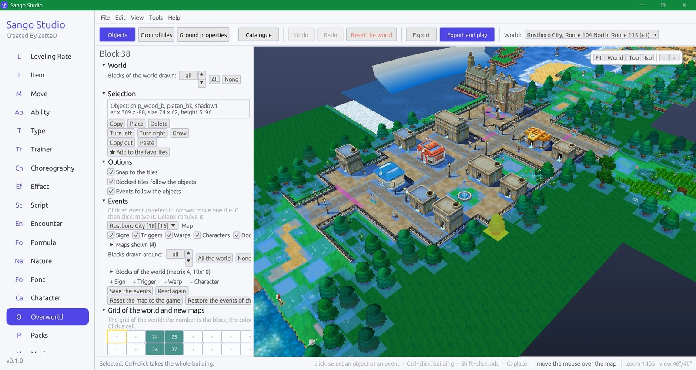</p>

---

## How it works

Sango Studio never changes the files of the game. It works with two folders:

| Folder | What it is |
| --- | --- |
| **The dump** | A copy of the romfs of Alpha Sapphire 1.4. Studio only reads it. |
| **The SD card** | The folder `sdmc/sango-studio`. Studio writes your changes there. |

The Sango plugin, in the game, reads the files of the SD card instead of the files of the game. Many changes show at once, while the
game runs. Some changes need a restart of the game: the page tells you.

Studio keeps its own files (packs, exports, settings) in `%APPDATA%\SangoStudio`. The SD card only gets the files that the plugin
reads. See [Where the files are](docs/storage.md).

<p align="center">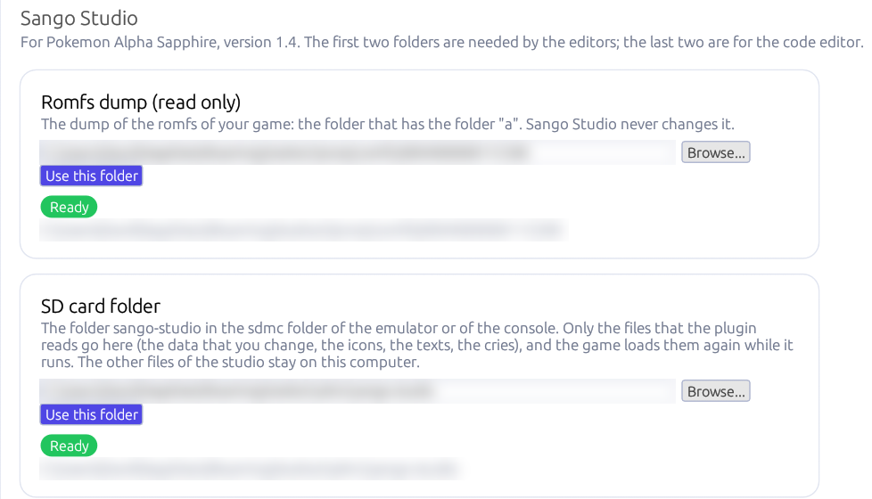</p>

## The pages

### Pokémon

| Page | What you can do |
| --- | --- |
| **Species** | Base stats, types, abilities, items, growth, Pokédex data, learnsets, evolutions, Mega Evolutions, texts, icons, cries and 3D models. Export and import CSV. |
| **Packs** | Add new species (number 724 and more) with their models, icons and cries. Turn on or off each part of a pack. |
| **Leveling Rate** | Edit the experience curves with draggable points. |
| **Formula** · **Nature** | Change how the game calculates the stats and the shiny chance. Change the effect of each nature, add new natures. |

<table><tr>
<td>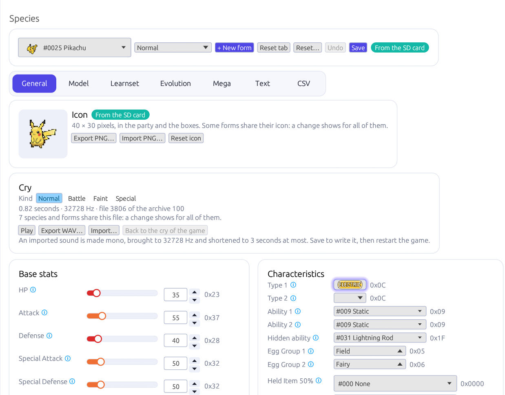</td>
<td>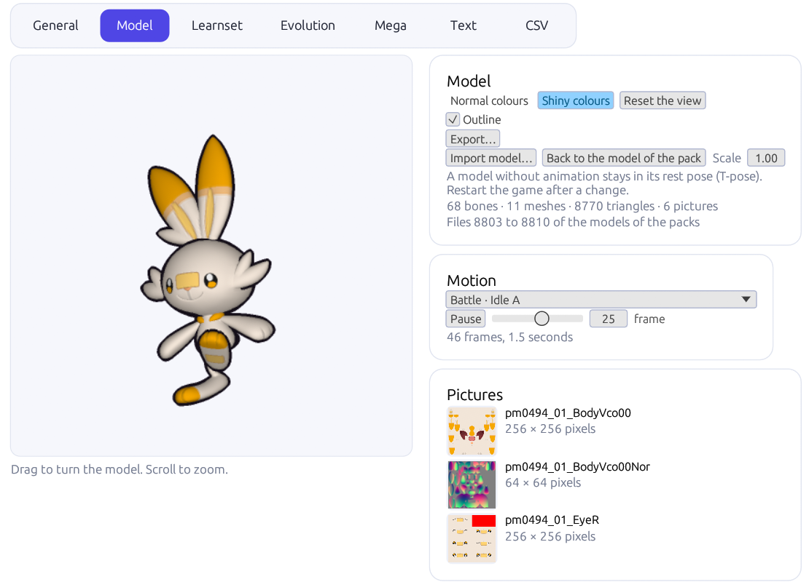</td>
</tr></table>
<p align="center">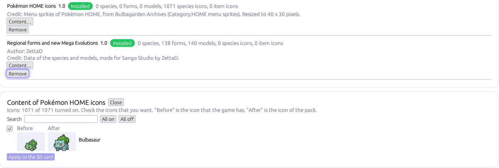</p>

### Battle

| Page | What you can do |
| --- | --- |
| **Move** | Power, accuracy, type, category, flags, effects, texts. Add new moves. |
| **Ability** | Names and texts. Write new abilities with *When / If / Then* rules. |
| **Item** | Prices, effects, pockets, icons, texts. Add new items. |
| **Type** | The type chart and the type icons. Add new types. |
| **Trainer** | The 949 trainers and their teams, the 280 classes, their models. |
| **Choreography** | The steps of a move animation on a timeline: camera, effects, sounds, poses. A preview plays the move as a battle, with the two Pokémon of your choice, the camera and the effects. |
| **Effect** | The particle effects of the battles, with a live preview. |

<table><tr>
<td>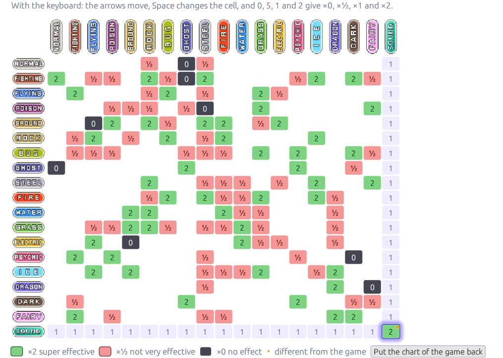</td>
<td>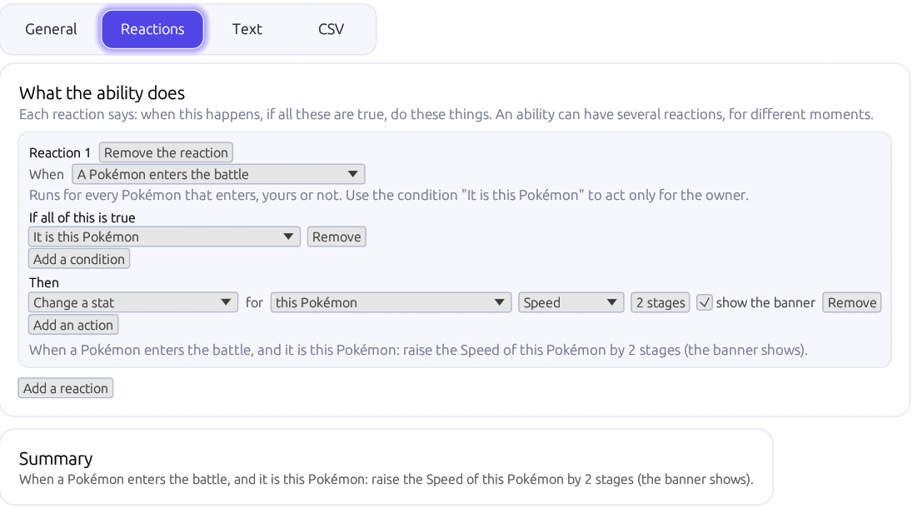</td>
</tr></table>
<p align="center">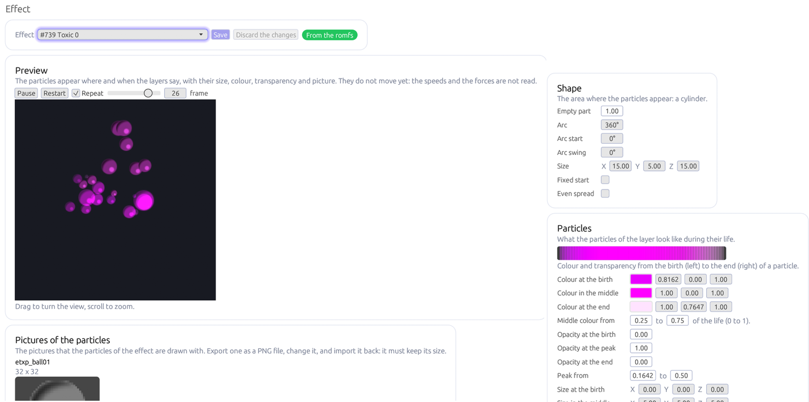</p>

### World

| Page | What you can do |
| --- | --- |
| **Overworld** | The maps in 3D: paint the tiles, move the warps, the signs and the characters, edit the zones. |
| **Encounter** | The wild Pokémon of each map and the DexNav. |
| **Character** | Export and import the 3D models of the characters. Swap a character for another one. |
| **Script** | Read and write the field scripts, with a built-in assembler. |

<p align="center">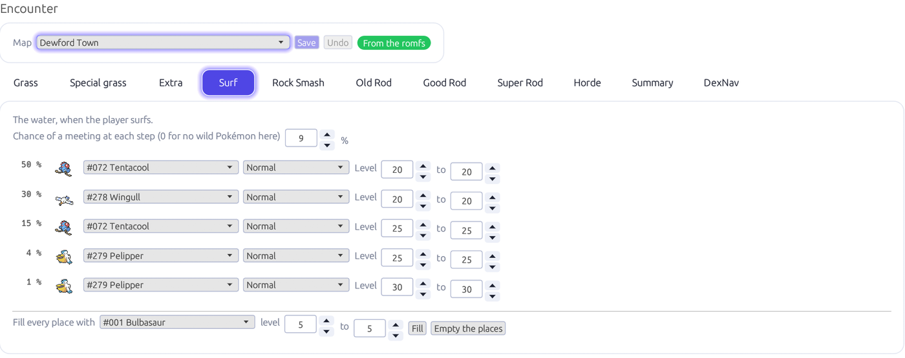</p>

### Sound and text

| Page | What you can do |
| --- | --- |
| **Music** | Listen to the musics, the jingles and the sound effects. Export them as WAV or MP3. Replace them with your own files. |
| **Font** | See the fonts of the game. Draw over the sheet of glyphs, or make the glyphs from a font of your computer. |

<p align="center">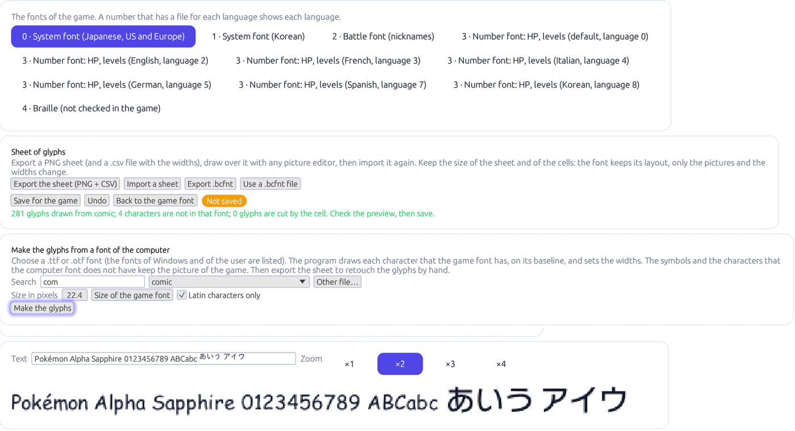</p>

### Tools

| Page | What you can do |
| --- | --- |
| **Archive** | Look inside any archive of the game: its files, its languages, the bytes. |
| **Code** | Write C++ code for the plugin, with completion, and compile it with devkitARM. |

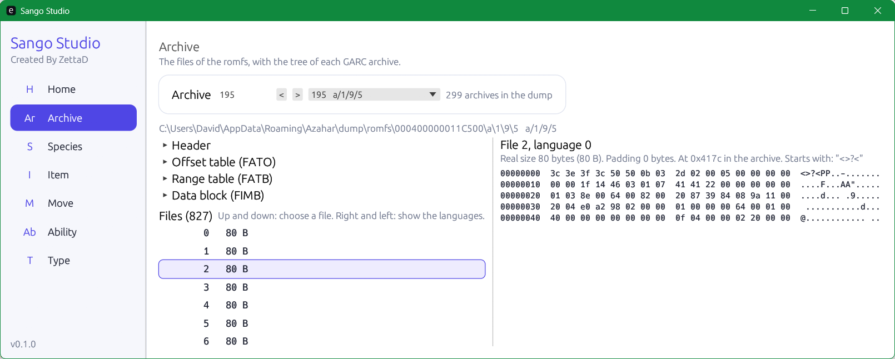

## Build and run

You need the [Rust toolchain](https://rustup.rs) (stable). The **Code** page also needs [devkitPro](https://devkitpro.org) with
devkitARM.

```
cargo run --release
```

The first build takes a few minutes. After that, a change compiles again in a few seconds.

| Variable | Effect |
| --- | --- |
| `SANGO_WORKSPACE` | Use another folder than `%APPDATA%\SangoStudio\workspace`. |
| `SANGO_BACKEND` | `vulkan` (default), `dx12` or `gl`. Try another one if the window does not open. |
| `SANGO_PAGE` | Open a page at start, by its place in the side bar (`2` is Species). |
| `SANGO_DUMP` | The dump that the tests use. Without it, the tests that need the game are skipped. |

```
cargo test --workspace
```

## For developers

The code is one crate per page in `module/`, plus a few shared crates:

| Crate | Role |
| --- | --- |
| `core` | The file formats of the game (archives, textures, models, texts) and the SD card. No interface. |
| `ui` | The theme, the widgets and the keyboard navigation that all the pages share. |
| `species_base` | The names, the data and the icons of the species, and the menus of types, for the other pages. |
| `stage` | The preview of the Choreography page: the steps played as a battle, drawn on the processor. |
| `pack` | The format of the packs and the library of installed packs. |

To add a page: copy a small crate (for example `module/nature`), implement `sango_ui::Module`, and add it to the list in
`app/src/main.rs`. The rules of the interface are in [ux-rules.md](docs/ux-rules.md).

More documents: [species packs](docs/species-packs.md) · [trainers](docs/trainers.md) · [encounters](docs/encounter.md) ·
[characters](docs/character.md) · [music](docs/music.md) · [cries](docs/cries.md) · [fonts](docs/font.md) ·
[formulas](docs/formula.md) · [script API](docs/script-api.md).

## Legal

This repository has no data of the game. You need your own copy of Alpha Sapphire and your own dump. Pokémon is a trademark of
Nintendo, Creatures and Game Freak. Sango Studio is a fan project and is not linked to them.
