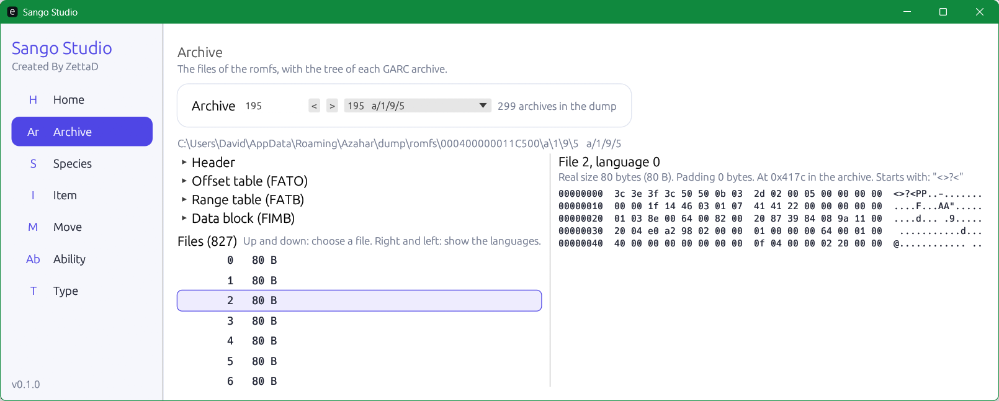

# Sango Studio

Studio for Pokemon Alpha Sapphire, version 1.4 only. It needs a dump of the romfs of the game (chosen in Home).



```
cargo run --release
```

One crate per page in `module/`. To add one, copy a crate, implement `sango_ui::Module`, add it in `app/src/main.rs`.

No game data in this repository.
